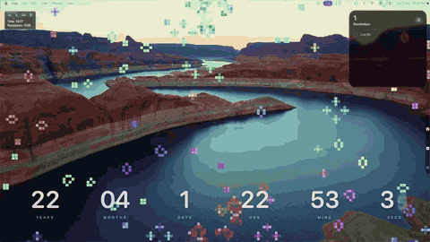

# life 🧬

Conway's Game of Life where every live cell contains another Game of Life — a recursive, colorful cellular automaton rendered with pygame, zoomable in real time.
And you can keep the game as your wallpaper.

<div align="center"></div>

## Demo

<div align="center"></div>

## Install

**Needs:** Python 3.10 or newer, plus [pipx](https://pipx.pypa.io) (`brew install pipx`) or
[uv](https://docs.astral.sh/uv/) (`brew install uv`). uv downloads a Python for you if you don't have one.

Install, then start it at every login (macOS). No clone or venv needed:

```sh
pipx install git+https://github.com/mayank-devac/life    # or: uv tool install git+https://github.com/mayank-devac/life
life --login install      # wallpaper now, and at every login
```

Other commands:

```sh
life                      # transparent floating window
life --wallpaper          # live wallpaper, just this once (macOS)
life --wallpaper -d       # same, in the background: the terminal hides and you can close it
life --stop               # stop a copy started with -d (or press Ctrl+Shift+Esc)
life --make-app           # a "Life in Life" app, to open it again from Spotlight / Dock
life --help               # every option

life --login status       # is it installed / running?
life --login              # settings window: colour, speed, wallpaper/window, size, monitor
life --login color mauve  # or set them directly: speed 4, monitor 2
life --login monitors     # list monitors and their numbers
life --login reset        # forget colour / speed / monitor choices
life --login uninstall    # stop starting at login
```

**Background (`-d` / `--detach`):** the terminal running `life` would otherwise sit on top of
the wallpaper. With `-d` it starts in the background, gives the terminal back, and (in wallpaper
mode) hides the terminal app; Cmd+Tab brings it back. Closing the terminal doesn't stop it.
To **restart** it (e.g. after changing options), run the same `life ... -d` command again: it
replaces the copy that's running. After `life --stop` or Ctrl+Shift+Esc, start it again the same way.
Its output goes to `~/Library/Logs/life-detached.log`.

**Open it again without a terminal:** run `life --make-app` once. It puts a **Life in Life** app
in `~/Applications`, so after closing it (Ctrl+Shift+Esc) you can start it again from Spotlight
(Cmd+Space, "Life in Life"), Launchpad or Finder, or drag it to the Dock. If you used
`life --login install`, the app restarts that one, with its settings; otherwise it runs like
`life -d` with your saved colour, mode and monitor. Opening it while it's already running does nothing.

Update with `pipx upgrade lifeinlife` (or `uv tool upgrade lifeinlife`).

`life --login …` takes the same commands as `./login.sh` below. From a clone, `./login.sh install`
also uses the installed `life` if there is one, instead of copying the code.

## Run from a clone

```sh
pip install -r requirements.txt
python "life inside life.py"               # transparent floating window
python "life inside life.py" --wallpaper    # live wallpaper behind desktop icons (macOS)
```

## Live wallpaper

Edit the settings at the top of `wall.sh` (opacity, colour, monitor, zoom…), then:

```sh
./wall.sh                 # run it now (Ctrl+C or Ctrl+Shift+Esc to stop)
./wall.sh -d              # run it in the background; the terminal hides (life --stop to stop)
./login.sh install        # start it at every login
./login.sh status
./login.sh uninstall
```

`login.sh install` copies the app to `~/Library/Application Support/life-wallpaper` with its own
Python environment, because macOS won't let login items read Downloads, Desktop or Documents.
After editing `wall.sh`, run `./login.sh install` again to apply it. Logs: `~/Library/Logs/life-wallpaper.log`.

### Change colour, mode, size or monitor (no need to edit `wall.sh`)

Press **`Ctrl+Shift + S`** while it's running (pinned or not, wallpaper or window): a small
window asks for a colour, a speed, **wallpaper or window**, the window's size (for a window),
then a monitor, and it changes on the spot. Switching to *Window* turns the wallpaper into a
normal movable window; switching to *Wallpaper* makes a window fill its monitor behind your
icons. The mode and size are remembered too: a plain `life` starts in the mode you last
picked (`life --window` / `life --wallpaper` override it). From the terminal:

```sh
./login.sh                # the same window
./login.sh color mauve    # or straight from the terminal (a hex like ff8800 works too)
./login.sh monitor 2
./login.sh monitors       # list monitors and their numbers
./login.sh reset          # go back to the values in wall.sh
```

Changes apply right away and stick across logins (and across `./login.sh install`): they're
saved in a `settings` file next to `wall.sh`, which wins over the values written in `wall.sh`.
If it isn't installed yet, these install it first.

## Controls

| Key | Action |
|---|---|
| Click / drag | draw cells (start the drag on a live cell to erase instead) |
| Right-drag / Option + drag | pan (when zoomed in) |
| `Ctrl+Shift + drag` | move the window |
| Scroll / `Ctrl+Shift + = -` | zoom |
| `Ctrl+Shift + P` | next brush: cell, glider, LWSS, pulsar, Gosper glider gun, R-pentomino, acorn |
| `Ctrl+Shift + T` | rotate the brush 90° |
| `Ctrl+Shift + C` | clear the world (it isn't replaced by a random one until it has cells again) |
| `Ctrl+Shift + Space` | pause / resume |
| `Ctrl+Shift + Left / Right` | step back / forward one generation (back through the last ~200) |
| `Ctrl+Shift + , / .` | slower / faster |
| `Ctrl+Shift + R` | new random world |
| `Ctrl+Shift + X` | save the world as `.rle` in `~/life-worlds/` |
| `Ctrl+Shift + L / I` | next rule: outer / inner worlds |
| `Ctrl+Shift + E` | edges: wrap around / dead |
| `Ctrl+Shift + K` | next colour theme |
| `Ctrl+Shift + F` | effects: trails, age glow, flashes |
| `Ctrl+Shift + S` | settings: colour, speed, wallpaper or window (and its size), monitor |
| **`Ctrl+Shift + W`** | **pin to desktop (wallpaper) / unpin** |
| `Ctrl+Shift + Up / Down` | opacity |
| `Ctrl+Shift + H` | help |
| `Ctrl+Shift + Esc` | quit |

> [!IMPORTANT]
> **`Ctrl+Shift + W` is the key to remember.** While pinned as a wallpaper, only `Ctrl+Shift + W`,
> `Ctrl+Shift + S` and `Ctrl+Shift + Esc` are captured system-wide, so other apps keep their shortcuts.
> Press **`Ctrl+Shift + W`** (or the pin button on the panel) to unpin and get the rest back.

### The control panel

A small panel in the top-left corner has buttons for **step back**, **play**, **pause**,
**faster** (Option-click: slower; it wraps round from the fastest to the slowest), and
**pin / unpin**. It also shows the world's **Time** (generations since it was seeded),
**Population** (live cells), and the rule and speed.
Unpinned, it rides along on the window's corner. Pinned, it sits in the screen's corner just
above the desktop icons, so app windows still cover it. You can drag it anywhere.

The last button hides the panel. Pinned it's an **eye-with-slash**, and the panel disappears;
press `Ctrl+Shift + W` to go interactive and click the **eye** that stays in the corner to
bring it back. Unpinned it's a **✕** that collapses the panel down to just the eye.

### Patterns and worlds

- **Brushes:** pick one with `Ctrl+Shift + P` and click to place it. A see-through preview
  follows the mouse.
- **Rewind:** step back works through the last ~200 generations, and also undoes a clear, a
  new random world, a brush stroke, a stamp or a load. The little worlds inside each cell
  don't rewind; they carry on as they are.
- **Save / load:** `Ctrl+Shift + X` saves to `~/life-worlds/world-<date>-<time>.rle` (the
  standard Life pattern format, readable by Golly and LifeViewer). Load one with
  `--load file.rle`, or drag a `.rle` / `.cells` file onto the window.

## As a wallpaper, it stays out of the way

- Zoomed out it wakes about twice a second (when the outer world steps) instead of 30 times,
  and only redraws when something changed.
- It pauses while the screen is locked, the display is asleep, or another user is logged in.
- If the chosen monitor is plugged in later, unplugged, or changes resolution, it moves and
  resizes to cover it again. If it disappears (e.g. an HDMI screen waking up slowly after
  sleep), it waits 10 s for it to come back before falling back to the primary monitor.
- `launchctl` / logout (SIGTERM) shuts it down cleanly; the log trims itself past 1 MB.

## Code layout

```
life inside life.py      launcher (kept so the commands above stay the same)
lifeinlife/
  config.py              constants: sizes, speeds, colours, help text
  colors.py              --color parsing, hue -> RGB
  settings.py            Ctrl+Shift+S dialog, saved colour / monitor
  world.py               the simulation (numpy only, no pygame)
  rules.py               Life-like rules (B3/S23 notation), presets, stepping
  patterns.py            brushes (glider, gun...), .rle / .cells reading and writing
  view.py                zoom / pan / resize maths
  render.py              drawing: world texture, inner worlds, help, toasts
  app.py                 window, input, actions, main loop
  cli.py                 command-line options, life --login
  login.sh, wall.sh      start-at-login and wallpaper scripts (the repo root links to these)
  mac/window.py          transparent + pinned window, monitor list
  mac/hotkeys.py         system-wide shortcuts (no permission prompt)
  mac/hud.py             control panel: step back, play/pause, faster, pin
  mac/visibility.py      screen locked / display asleep checks
tests/                   python -m unittest discover -s tests -t .
```

>Tested on macOS; it may also work on Windows, though this has not been fully verified.
>
> If anything breaks, `LIFE_FROM_SOURCE=1 ./login.sh install` puts you back on the source version.
