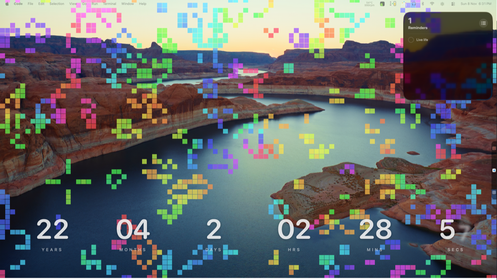

# life 🧬

Conway's Game of Life where every live cell contains another Game of Life — a recursive, colorful cellular automaton rendered with pygame, zoomable in real time.
And you can keep the game as your wallpaper.

## Demo
<div align="right"><sub>▶ Click image to watch the demo (56s, 6.8 MB)</sub></div>
<div align="center"><a href="docs/life0.mp4"></a></div>

## Run

```sh
pip install -r requirements.txt
python "life inside life.py"               # transparent floating window
python "life inside life.py" --wallpaper    # live wallpaper behind desktop icons (macOS)
```

## Live wallpaper

Edit the settings at the top of `wall.sh` (opacity, colour, monitor, zoom…), then:

```sh
./wall.sh                 # run it now (Ctrl+C or Ctrl+Shift+Esc to stop)
./login.sh install        # start it at every login
./login.sh status
./login.sh uninstall
```

`login.sh install` copies the app to `~/Library/Application Support/life-wallpaper` with its own
Python environment, because macOS won't let login items read Downloads, Desktop or Documents.
After editing `wall.sh`, run `./login.sh install` again to apply it. Logs: `~/Library/Logs/life-wallpaper.log`.

### Change colour or monitor (no need to edit `wall.sh`)

Press **`Ctrl+Shift + S`** while it's running (pinned or not): a small window asks for a
colour, then a monitor, and the wallpaper changes on the spot. From the terminal:

```sh
./login.sh                # the same window
./login.sh color mauve    # or straight from the terminal (a hex like ff8800 works too)
./login.sh monitor 2
./login.sh monitors       # list monitors and their numbers
./login.sh reset          # go back to the values in wall.sh
```

Changes apply right away and stick across logins (and across `./login.sh install`): they're
saved in a `settings` file next to `wall.sh`, which wins over the values written in `wall.sh`.
If it isn't installed yet, these install it first.

## Controls

| Key | Action |
|---|---|
| Click / drag | draw cells (start the drag on a live cell to erase instead) |
| Right-drag / Option + drag | pan (when zoomed in) |
| `Ctrl+Shift + drag` | move the window |
| Scroll / `Ctrl+Shift + = -` | zoom |
| `Ctrl+Shift + P` | next brush: cell, glider, LWSS, pulsar, Gosper glider gun, R-pentomino, acorn |
| `Ctrl+Shift + T` | rotate the brush 90° |
| `Ctrl+Shift + C` | clear the world (it isn't replaced by a random one until it has cells again) |
| `Ctrl+Shift + Space` | pause / resume |
| `Ctrl+Shift + Left / Right` | step back / forward one generation (back through the last ~200) |
| `Ctrl+Shift + , / .` | slower / faster |
| `Ctrl+Shift + R` | new random world |
| `Ctrl+Shift + X` | save the world as `.rle` in `~/life-worlds/` |
| `Ctrl+Shift + L / I` | next rule: outer / inner worlds |
| `Ctrl+Shift + E` | edges: wrap around / dead |
| `Ctrl+Shift + K` | next colour theme |
| `Ctrl+Shift + F` | effects: trails, age glow, flashes |
| `Ctrl+Shift + S` | settings: colour, speed and monitor |
| **`Ctrl+Shift + W`** | **pin to desktop (wallpaper) / unpin** |
| `Ctrl+Shift + Up / Down` | opacity |
| `Ctrl+Shift + H` | help |
| `Ctrl+Shift + Esc` | quit |

> [!IMPORTANT]
> **`Ctrl+Shift + W` is the key to remember.** While pinned as a wallpaper, only `Ctrl+Shift + W`,
> `Ctrl+Shift + S` and `Ctrl+Shift + Esc` are captured system-wide, so other apps keep their shortcuts.
> Press **`Ctrl+Shift + W`** (or the pin button on the panel) to unpin and get the rest back.

### The control panel

A small panel in the top-left corner has buttons for **step back**, **play**, **pause**,
**faster** (Option-click: slower; it wraps round from the fastest to the slowest), and
**pin / unpin**. It also shows the world's **Time** (generations since it was seeded),
**Population** (live cells), and the rule and speed.
Unpinned, it rides along on the window's corner. Pinned, it sits in the screen's corner just
above the desktop icons, so app windows still cover it.

### Patterns and worlds

- **Brushes:** pick one with `Ctrl+Shift + P` and click to place it. A see-through preview
  follows the mouse.
- **Rewind:** step back works through the last ~200 generations, and also undoes a clear, a
  new random world, a brush stroke, a stamp or a load. The little worlds inside each cell
  don't rewind; they carry on as they are.
- **Save / load:** `Ctrl+Shift + X` saves to `~/life-worlds/world-<date>-<time>.rle` (the
  standard Life pattern format, readable by Golly and LifeViewer). Load one with
  `--load file.rle`, or drag a `.rle` / `.cells` file onto the window.

## As a wallpaper, it stays out of the way

- Zoomed out it wakes about twice a second (when the outer world steps) instead of 30 times,
  and only redraws when something changed.
- It pauses while the screen is locked, the display is asleep, or another user is logged in.
- If the chosen monitor is plugged in later, unplugged, or changes resolution, it moves and
  resizes to cover it again. If it disappears (e.g. an HDMI screen waking up slowly after
  sleep), it waits 10 s for it to come back before falling back to the primary monitor.
- `launchctl` / logout (SIGTERM) shuts it down cleanly; the log trims itself past 1 MB.

## Code layout

```
life inside life.py      launcher (kept so the commands above stay the same)
lifeinlife/
  config.py              constants: sizes, speeds, colours, help text
  colors.py              --color parsing, hue -> RGB
  settings.py            Ctrl+Shift+S dialog, saved colour / monitor
  world.py               the simulation (numpy only, no pygame)
  rules.py               Life-like rules (B3/S23 notation), presets, stepping
  patterns.py            brushes (glider, gun...), .rle / .cells reading and writing
  view.py                zoom / pan / resize maths
  render.py              drawing: world texture, inner worlds, help, toasts
  app.py                 window, input, actions, main loop
  cli.py                 command-line options
  mac/window.py          transparent + pinned window, monitor list
  mac/hotkeys.py         system-wide shortcuts (no permission prompt)
  mac/hud.py             control panel: step back, play/pause, faster, pin
  mac/visibility.py      screen locked / display asleep checks
tests/                   python -m unittest discover -s tests -t .
```
